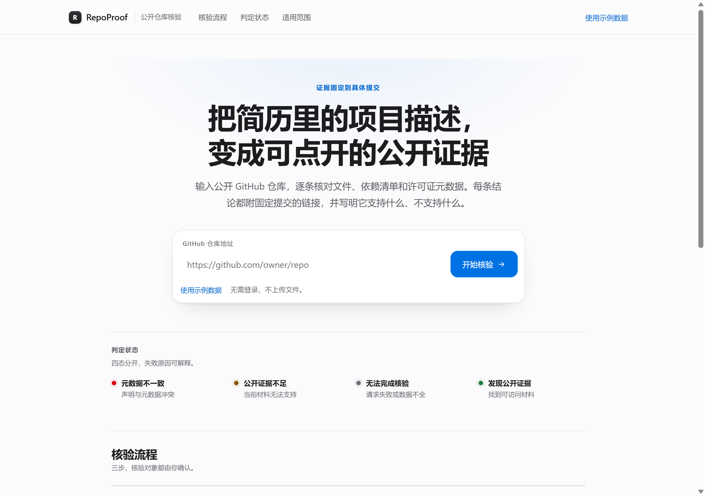
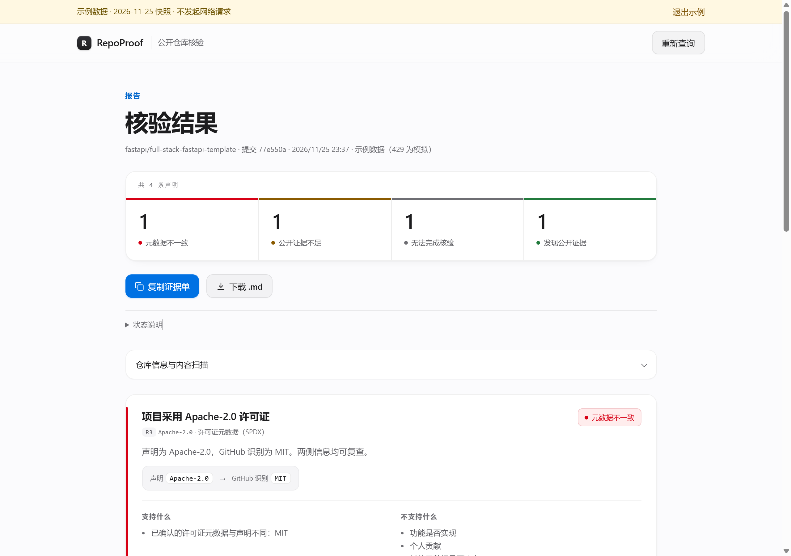
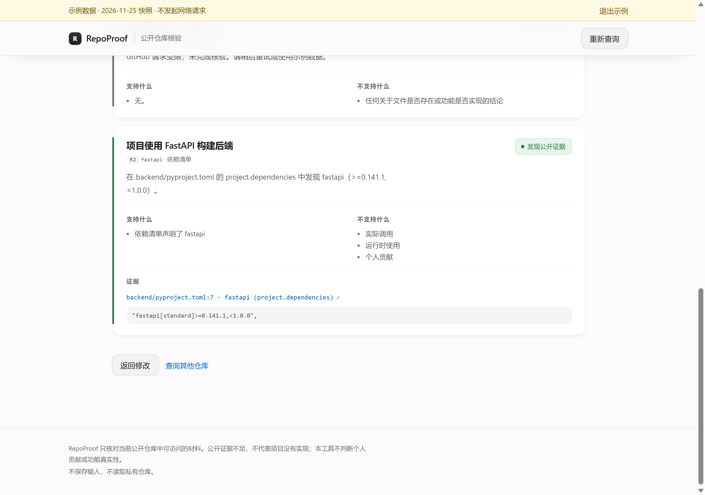
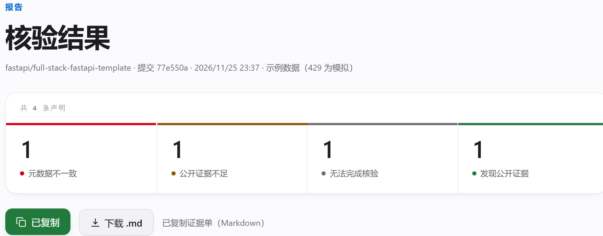
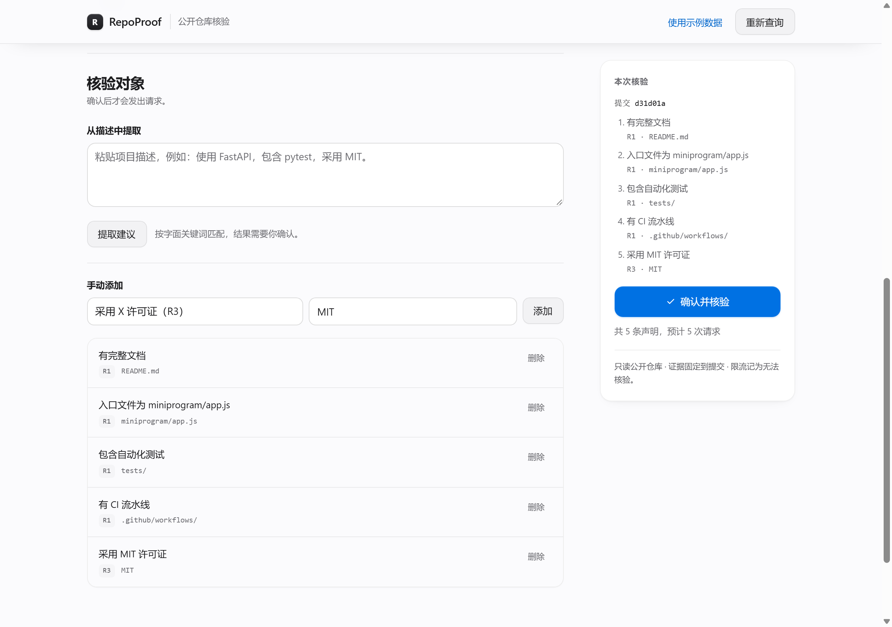
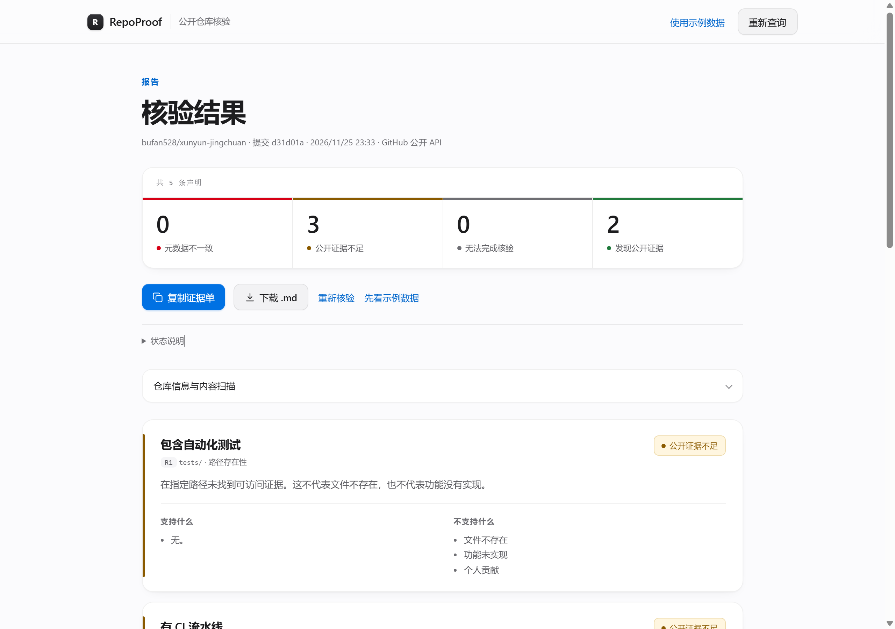
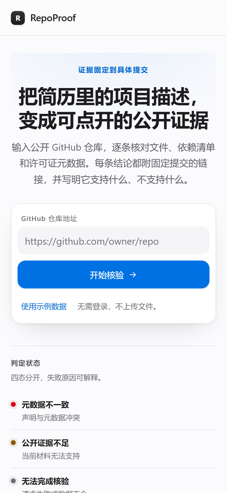

# 【StudyHack 学习科研】RepoProof：把简历里的项目描述，变成可点开的 GitHub 证据

> 作品链接：<https://repoproof-m4h0tvkp9cl.qoder.website>  
> 提交人：【姓名】｜【学校】软件工程 2024 级｜【个人/团队，如为团队请补充分工】

## 一、自我介绍

我是【姓名】，【学校】软件工程专业 2024 级本科生。这个 MVP 由我独立完成。

准备 2027 暑期实习时，我反复遇到一个很具体的问题：简历上写了“使用 FastAPI 构建后端”“包含自动化测试”“采用 MIT 许可证”，但要把这些说法变成面试官能当场点开的材料，需要翻很多目录。GitHub 页面能展示文件，却不负责回答：这条描述对应哪份材料、找到了说明什么、没找到又说明什么。

我用 Qoder 完成规格拆解、核心规则、清单解析、前端、测试和部署；判定口径、文案边界和最终验收由我逐项检查。

## 二、作品是什么

RepoProof 是一个给准备实习、校招、保研、有公开 GitHub 项目的大学生用的证据核验器：面试前 10 分钟，把简历里的项目描述逐条连到公开仓库里能点开的文件、依赖清单和许可证，生成一份可复查的证据清单。

它不是简历评分，不做真假判断，也不判断个人贡献。它只回答一个更窄的问题：这条描述，在当前公开仓库里能找到什么证据；这些证据支持什么、不支持什么。

## 三、为什么做

### 1. 真实场景

简历上写“使用 FastAPI”“有测试”“MIT 许可证”，面试官追问“在哪”，常见的反应是打开仓库开始翻。仓库文件很多，目录层级也不一定符合简历的写法；更麻烦的是，即使找到了某个文件，也不代表它能支持简历里的全部含义。

AI 生成代码让“有仓库”这件事变得更弱：仓库存在，不等于能力证明。但反过来，“看起来像假的”也不能靠猜。更可靠的做法，是把可公开复查的材料摆出来，并明确它支持到哪里。

我没有编造访谈数据，也没有使用无法核实的比例或“抓假”叙事。这个产品要解决的是“把证据入口整理清楚”，而不是替任何人下真假结论。

### 2. 我先拿自己的仓库试了一遍

我用 RepoProof 核验了自己的公开仓库 [bufan528/xunyun-jingchuan](https://github.com/bufan528/xunyun-jingchuan)，固定在提交 `d31d01a4da79087f2bdd50a6b09ecbbbc4b23b7a`，查询时间为 2026-11-25 23:33。

| 声明 | 核验对象 | 结果 | 公开证据 |
|---|---|---|---|
| 有完整文档 | `README.md` | 发现公开证据 | [README.md](https://github.com/bufan528/xunyun-jingchuan/blob/d31d01a4da79087f2bdd50a6b09ecbbbc4b23b7a/README.md) |
| 入口文件为 `miniprogram/app.js` | `miniprogram/app.js` | 发现公开证据 | [miniprogram/app.js](https://github.com/bufan528/xunyun-jingchuan/blob/d31d01a4da79087f2bdd50a6b09ecbbbc4b23b7a/miniprogram/app.js) |
| 包含自动化测试 | `tests/` | 公开证据不足 | [Contents API 查询](https://api.github.com/repos/bufan528/xunyun-jingchuan/contents/tests?ref=d31d01a4da79087f2bdd50a6b09ecbbbc4b23b7a) |
| 有 CI 流水线 | `.github/workflows/` | 公开证据不足 | [Contents API 查询](https://api.github.com/repos/bufan528/xunyun-jingchuan/contents/.github/workflows?ref=d31d01a4da79087f2bdd50a6b09ecbbbc4b23b7a) |
| 采用 MIT 许可证 | `MIT` | 公开证据不足 | [License API 查询](https://api.github.com/repos/bufan528/xunyun-jingchuan/license) |

结果是：5 条声明，2 条发现公开证据，3 条公开证据不足，0 条元数据不一致，0 条无法完成核验。

三条“证据不足”分别是：

- `tests/` 这个路径没有可访问证据。它只说明该路径没有找到材料，不说明仓库里没有任何测试脚本，更不说明我没有做测试。
- `.github/workflows/` 这个路径没有可访问证据。同上，不能推出“没有 CI”。
- GitHub 的许可证接口没有返回 SPDX 标识。结果写的是“未识别出可用的 SPDX 许可证元数据”，而不是“无许可证”。这两句话差别很大。

这张结果单最重要的地方，不是三条“证据不足”，而是它没有把这三条写成对项目的否定结论。这也是我决定把它做成产品的原因。

## 四、怎么用（5 步）

1. 打开作品链接，看到仓库地址输入框和四种判定状态的说明。

   

2. 点“使用示例数据”。示例固定在提交 `77e550a`，不发起网络请求，四种状态各一条：许可证不一致、路径证据不足、请求受限、依赖清单命中。

   

3. 点开任意一条证据，回到固定提交的 GitHub 原文；每条结果都同时写“支持什么”和“不支持什么”。示例结果可以一键复制成 Markdown 证据单，固定提交链接和边界会一起带走。

   

   

4. 输入自己的公开仓库，确认核验对象和预计请求数。所有对象都需要用户确认后才会执行。

   

5. 点“确认并核验”，查看结果；可以点“复制证据单”把四态、固定提交链接和边界复制成 Markdown，也可以复制完整 commit SHA 后点证据链接复查。手机端同样可以完成这条路径。

   

   

示例里的 429 是快照中模拟的，用来展示“无法完成核验”；真实模式遇到 403/429 也按同一口径处理。

## 五、用 Qoder 做出来的过程

### 1. 分工

| 阶段 | 交给 Qoder | 我负责检查与修正 |
|---|---|---|
| 规格 | 拆解官方作品帖五部分、四态、三条禁令 | 冻结判定口径；删掉“真假、评分、通过率”等表述 |
| 核心 | 实现 R1 路径、R2 清单、R3 许可证、R4 目录清点 | 检查 404、license null、429、tree truncated 的文案与状态 |
| 解析 | `package.json`、`requirements.txt`、`pyproject.toml`（PEP 621 / PEP 735 / Poetry）、`pom.xml`、`go.mod`、`Gemfile` | 补别名归一化、依赖分组和边界用例 |
| 前端 | 单栏文档式排版、结果卡片、克制的转场与错峰入场、移动端适配 | 否掉第一版“大标题 + 三步卡片 + 胶囊徽章”的模板化风格，收紧文案并去掉重复的状态图例 |
| 测试 | 核心与应用用例 | 补四态排序、示例快照复现、truncated 场景、证据单导出 |
| 部署 | 静态构建、Qoder Sites | 验证公网零登录、375px、429 失败态 |

### 2. 五个必须由人定口径的地方

Qoder 能快速给出实现，但下面这些地方如果直接采用，产品就会说过头。我在验收时逐条改了：

1. **404 不能写成“文件不存在”。** 改成“公开证据不足”，并在“不支持什么”里明确列出：文件不存在、功能未实现、个人贡献；结果页摘要也统一用“公开证据不足”，不用“未找到”。
2. **license null / NOASSERTION 不能写成“无许可证”。** 改成“未识别出可用的 SPDX 许可证元数据”，状态是“公开证据不足”，不是“元数据不一致”。
3. **提交时间不能当证据。** “最近推送”只作为仓库信息展示，不参与任何判定；不用“很久没更新”推断项目状态。
4. **目录树截断不能拆成单文件缺失。** Tree 返回 `truncated` 时，整个清点判为“无法完成核验”，不把截断误写成“没有这个文件”。
5. **403/429 不能写成“证据不足”。** 取数失败就是“无法完成核验”，不能把平台限制算到项目头上。

另外两个工程决定：

- 示例快照固定在提交 `77e550a73bb49dd2967622c5ed11bf7a49603c93`，页面明确标注“示例快照，不发起网络请求”；其中的 429 也标注为模拟。
- 证据链接统一固定到 commit SHA，而不是默认分支，避免复查时文件已经变化。

### 3. 测试与交付

- 42 个用例全部通过：核心 27 个，应用 15 个。
- 覆盖四态排序（不一致 → 证据不足 → 无法完成核验 → 发现证据）、404 语义、license null、429、tree truncated、示例快照复现、证据单导出。
- Qoder Sites 公网静态页，无需登录；构建时把 `public/` 与 `src/` 复制到 `dist/` 并改写引用，不依赖后端。

### 4. Qoder 过程截图

以下位置需要从真实的 Qoder 会话、终端和部署页面截图；发布时把占位文字替换成图片。建议保留对话时间、文件名和终端输出，不要裁剪到无法辨认。

- **Q1 规格输入与任务拆解**：把官方五部分、四态、三条禁令贴给 Qoder，要求先拆任务再写代码。
- **Q2 模块设计**：`src/core`、`src/app`、`src/adapters` 的职责边界，以及“判定只在 core”的约束。
- **Q3 规则实现**：R1 路径、R2 清单、R3 许可证的代码与对应测试。
- **Q4 测试结果**：42/42 的终端输出，以及四态排序、404、license null 的用例名；如果有真实的失败→修复记录，优先放那一段，没有就只放通过结果，不要补造失败。
- **Q5 文案修正**：404、license null 与结果摘要的修改前后对比（“文件不存在”/“无许可证”/“未找到”改为“公开证据不足”/“未识别出 SPDX”）。
- **Q6 UI 重做**：第一版与现在的对比；说明为什么去掉大标题首屏、步骤卡片和胶囊徽章。
- **Q7 Qoder Sites 发布**：构建成功、发布成功、公网访问。
- **Q8 手机端验证**：375px 宽度下的首页、结果和证据链接。
- **Q9 tree truncated**：构造截断场景，确认清点判为“无法完成核验”。
- **Q10 429 失败态**：限流或断网时，声明判为“无法完成核验”，而不是“证据不足”。

## 六、边界、隐私与原创

- 只读取公开仓库；不需要登录，不上传简历，不保存输入。
- 不做真假判断，不判断个人贡献，不判断功能是否真正实现，也不做简历评分。
- 示例是固定提交的快照，标注日期和“不发起网络请求”；真实模式才访问 GitHub 公开 API。
- 代码与文案原创；视觉排版参考了 GitHub Docs 等公开文档站点的惯例，未复制其品牌素材。数据来源为 GitHub 公开 API。Qoder 参与了实现和文字初稿，人工修改与判定口径由我负责。
- 产品里最重要的一句话：**公开证据不足，不代表项目没有实现。**

## 七、当前限制

- 目前只覆盖三类可机械核验的声明：路径存在性、依赖清单声明、许可证 SPDX；外加目录清点，只用于发现，不参与判定。
- 不做自由文本 NLP 判定。用户粘贴描述后，系统只按字面关键词给建议，最终核验对象必须由用户确认。
- 不判断个人贡献、代码质量、测试覆盖率或功能真实性。
- GitHub 未认证 API 有配额限制；触发 403/429 时，对应声明判为“无法完成核验”，并提示稍后重试或使用示例。
- 示例是快照，不代表仓库最新状态；真实仓库复查时以页面上的 commit SHA 为准。

## 八、链接与材料

- 作品链接：<https://repoproof-m4h0tvkp9cl.qoder.website>
- 示例仓库：`fastapi/full-stack-fastapi-template`，提交 `77e550a73bb49dd2967622c5ed11bf7a49603c93`，快照日期 2026-11-25。
- 真实案例：`bufan528/xunyun-jingchuan`，提交 `d31d01a4da79087f2bdd50a6b09ecbbbc4b23b7a`，查询时间 2026-11-25 23:33。
- 测试：42 个用例全部通过。

---

## 发布前替换清单（提交时删除本节）

- [ ] 把【姓名】【学校】和团队分工换成真实信息；如果是个人提交，删掉“团队”相关表述。
- [ ] 把 Q1–Q10 的占位文字换成真实截图，至少 8 张；不要用产品截图冒充 Qoder 过程截图。
- [ ] 在天池编辑器中逐张上传 `screenshots/` 里的图片；本地相对路径在天池不会自动显示。
- [ ] 确认作品链接在无缓存、另一台设备上可以打开，且不需要登录。
- [ ] 检查文案：不出现“AI 判定真假”“简历评分”“官方要求 90 秒”“首创”等不实表述。
- [ ] 保留提交成功凭证和作品帖公开链接。
