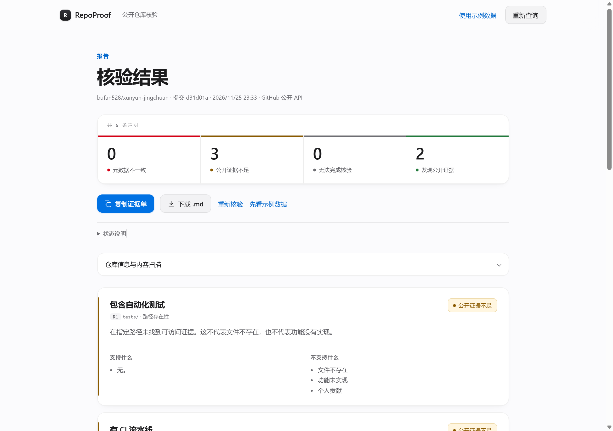
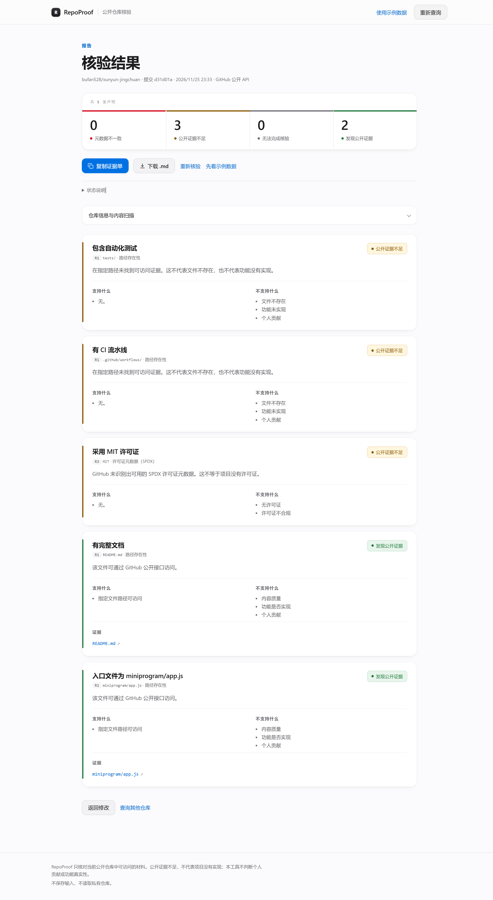

# 真实仓库端到端案例：bufan528/xunyun-jingchuan

> 仓库：<https://github.com/bufan528/xunyun-jingchuan>  
> 提交：`d31d01a4da79087f2bdd50a6b09ecbbbc4b23b7a`（main）  
> 查询时间：2026-11-25 23:33  
> 模式：真实查询，GitHub 公开 API；未使用示例快照  
> 作品链接：<https://repoproof-m4h0tvkp9cl.qoder.website>

## 1. 案例目的

这个案例不是为了证明“仓库有问题”，而是为了展示三件事：

1. 工具能把一条项目描述拆成可复查的核验对象，并把证据固定到具体提交。
2. “没找到”与“取数失败”“元数据冲突”“找到证据”是四种不同状态，不能混成“通过/不通过”。
3. 即使用自己的仓库，也会出现多条“公开证据不足”；这不代表项目没有实现。

## 2. 核验对象与结果

在页面输入仓库地址后，添加 5 条核验对象：

| # | 声明 | 规则 | 核验对象 | 结果 |
|---|---|---|---|---|
| 1 | 有完整文档 | R1 路径存在性 | `README.md` | 发现公开证据 |
| 2 | 入口文件为 `miniprogram/app.js` | R1 路径存在性 | `miniprogram/app.js` | 发现公开证据 |
| 3 | 包含自动化测试 | R1 路径存在性 | `tests/` | 公开证据不足 |
| 4 | 有 CI 流水线 | R1 路径存在性 | `.github/workflows/` | 公开证据不足 |
| 5 | 采用 MIT 许可证 | R3 许可证 SPDX | `MIT` | 公开证据不足 |

汇总：**共 5 条；0 条元数据不一致；3 条公开证据不足；0 条无法完成核验；2 条发现公开证据。**

完整结果页：

## 3. 逐条说明

### 3.1 找到的两条

**README.md（发现公开证据）**

- 证据链接：<https://github.com/bufan528/xunyun-jingchuan/blob/d31d01a4da79087f2bdd50a6b09ecbbbc4b23b7a/README.md>
- 工具原文：“该文件可通过 GitHub 公开接口访问。”
- 支持什么：指定文件路径可访问。
- 不支持什么：内容质量、功能是否实现、个人贡献。

**miniprogram/app.js（发现公开证据）**

- 证据链接：<https://github.com/bufan528/xunyun-jingchuan/blob/d31d01a4da79087f2bdd50a6b09ecbbbc4b23b7a/miniprogram/app.js>
- 工具原文：“该文件可通过 GitHub 公开接口访问。”
- 支持什么：指定文件路径可访问。
- 不支持什么：内容质量、功能是否实现、个人贡献。

这两条只证明“这个路径存在且可访问”，不证明“入口文件就是它”，也不证明“代码写得好”。

### 3.2 证据不足的三条

**tests/（公开证据不足）**

- 复查链接：<https://api.github.com/repos/bufan528/xunyun-jingchuan/contents/tests?ref=d31d01a4da79087f2bdd50a6b09ecbbbc4b23b7a>
- 该链接返回 404。
- 工具原文：“在指定路径未找到可访问证据。这不代表文件不存在，也不代表功能没有实现。”
- 支持什么：无。
- 不支持什么：文件不存在、功能未实现、个人贡献。

这里必须说清楚：这条声明是按 `tests/` 这个路径核验的。仓库里可能有其他形式的测试脚本，也可能测试写在别处；工具没有做代码搜索，也没有遍历所有目录去找“像测试的文件”。所以它只能说明：`tests/` 这个路径没有公开证据。

**`.github/workflows/`（公开证据不足）**

- 复查链接：<https://api.github.com/repos/bufan528/xunyun-jingchuan/contents/.github/workflows?ref=d31d01a4da79087f2bdd50a6b09ecbbbc4b23b7a>
- 该链接返回 404。
- 工具原文与边界同上。
- 同样，这只说明该路径没有公开证据，不能推出“没有 CI”。

**MIT（公开证据不足）**

- 复查链接：<https://api.github.com/repos/bufan528/xunyun-jingchuan/license>
- 该链接返回 404，表示 GitHub 没有识别出可用的 SPDX 许可证元数据。
- 工具原文：“GitHub 未识别出可用的 SPDX 许可证元数据。这不等于项目没有许可证。”
- 支持什么：无。
- 不支持什么：无许可证、许可证不合规。

这条为什么不是“元数据不一致”？因为“不一致”需要两边都有可比较的明确值：声明是 MIT，GitHub 识别出另一个 SPDX。这里只有声明，没有识别结果，所以只能判“公开证据不足”。把 404 或 null 写成“没有许可证”，正是这个产品要避免的误判。

> 注意：`/license` 接口不接收 ref，反映的是默认分支的当前状态；如果之后仓库新增许可证，复查结果可能变化。其余证据链接都固定到提交 `d31d01a`。

### 3.3 没有出现的两种状态

- **0 条元数据不一致**：本次五条声明里，没有“声明值与已识别元数据明确冲突”的情况。
- **0 条无法完成核验**：本次查询没有触发 429/403/网络失败，所有请求都拿到了明确响应。

这不是“结果不够丰富”，而是真实查询的正常样子。四态不是每次都出现；示例快照才把四态凑齐，用于演示。

## 4. 这张结果单能说明什么

| 能说明 | 不能说明 |
|---|---|
| `README.md` 与 `miniprogram/app.js` 在提交 `d31d01a` 可访问 | 这两个文件的内容质量 |
| `tests/` 路径在本次查询中没有可访问证据 | 仓库没有任何测试 |
| `.github/workflows/` 路径在本次查询中没有可访问证据 | 项目没有 CI |
| GitHub 未识别出 SPDX 许可证 | 项目没有许可证 |
| 每条结论都附了可复查链接 | 个人贡献、功能真实性、真假判断 |

## 5. 如何复查

1. 打开 <https://repoproof-m4h0tvkp9cl.qoder.website>。
2. 输入 `https://github.com/bufan528/xunyun-jingchuan`，等待仓库信息加载。
3. 手动添加 5 条核验对象：
   - 有完整文档：`README.md`
   - 入口文件：`miniprogram/app.js`
   - 包含自动化测试：`tests/`
   - 有 CI 流水线：`.github/workflows/`
   - 采用 MIT 许可证：`MIT`
4. 点“确认并核验”。
5. 点开任意证据链接，确认链接固定在提交 `d31d01a`；对比页面上的“支持什么/不支持什么”。
6. 点“复制证据单”，确认 Markdown 中同样写着固定提交、四态结果和边界。

如果 GitHub 未认证配额不足，页面会把对应声明判为“无法完成核验”，并提示稍后重试或使用示例。这是设计内的失败态，不是“项目有问题”。

## 6. 这个案例的局限

- 只覆盖了路径、许可证两类规则；没有验证依赖清单，也没有验证自由文本描述。
- 只检查了用户确认的 5 个对象，没有做全仓库代码搜索。
- 许可证接口不固定到 commit，复查时可能随默认分支变化。
- 真实结果会随仓库和 GitHub 识别结果变化；本案例只代表 2026-11-25 23:33 这一次查询。
- 工具不判断测试覆盖率、代码质量、个人贡献或功能真实性。

## 7. 为什么选这个案例

- 它是作者自己的仓库，声明与仓库事实之间的关系可以当面解释，不需要编造第三人案例。
- 结果不是“全绿”：2 条找到、3 条证据不足，能真实展示“证据不足”的写法。
- 没有刻意制造许可证冲突；MIT 这条是 GitHub 未识别 SPDX，正好用来区分“不一致”和“证据不足”。
- 所有证据链接都能点开复查，且固定到具体提交。

## 8. 相关截图

- 核验对象与请求预估：`screenshots/09-live-claims.png`
- 结果顶部：`screenshots/10-live-results-top.png`
- 完整结果：`screenshots/11-live-results-full.png`
- 找到证据的卡片：`screenshots/16-live-found-readme.png`
- 断网/取数失败演练（另一条声明）：`screenshots/20-unable-drill.png`
